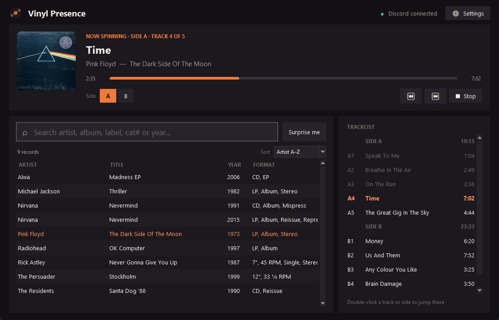

# Vinyl Presence

[](https://github.com/Y0ghurty/vinyl-presence/releases/latest)
[](https://discord.gg/vinylhangout)

Spotify-style Discord status for the records on your real turntable.

Pick the record you just put on in a small desktop window. Your Discord profile then shows the album
cover, the track, the artist and a progress bar that moves through each side, so everyone can see you're
spinning actual vinyl:

> **Listening to Record Player**
> Time
> Pink Floyd
> The Dark Side Of The Moon · Side A · on vinyl



- **Your own collection:** import the CSV export of your [Discogs](https://www.discogs.com) collection.
- **Fast search:** type a few letters of the artist, album, label, catalog number or year and press
  Enter. Small typos are fine.
- **Sides and tracks:** it knows each side's tracklist and track lengths, moves to the next track by
  itself, and asks you to flip the record when a side ends.
- **Cover view:** browse your collection as a wall of album covers, like flipping through your shelf.
- **Listening stats:** hours listened, your most played records and artists, hours per month, and a
  **Vinyl Wrapped** picture to paste into Discord.
- **Rediscover your shelf:** *Surprise me ▾* picks something you haven't played in a while, what you played
  on this day last year, or a record from a decade or genre.
- **Turntable care:** a flip reminder when a side ends, and a stylus counter that tells you when it's worn.
- **Last.fm scrobbling:** the tracks you play on your turntable count on your Last.fm profile.
- **Music videos on your TV:** play the video of the song that's on, on your Chromecast (an extra, optional).
- **Now spinning channel:** optionally post what you play to a channel in a Discord server, or, as a
  server owner, run a bot that posts what all your members play.
- **Live page:** optionally show what you're spinning on [vinylhangout.com](https://vinylhangout.com/#live),
  next to everyone else who's playing a record right now, post it in the Vinyl Hangout Discord, and get your own
  member page with your stats and achievements.
- **Collection value:** optionally see what your collection is worth on the Discogs marketplace, and which
  records are your most valuable.
- **Achievements:** 28 badges to earn, from *First drop* to *Vinyl legend*, with your progress in *Stats*.
- **Want list:** optionally see who in Vinyl Hangout has a record from your Discogs want list, and who's
  looking for one you have.
- **Stays out of the way:** it runs in the tray next to the clock and can start with Windows.
- **A normal Windows app:** nothing to host, no account, no server.

## Download

1. Download **`VinylPresence.exe`** from the [latest release](https://github.com/Y0ghurty/vinyl-presence/releases/latest).
2. Double-click it. The app isn't code-signed, so Windows may say *"Windows protected your PC"*: click
   **More info → Run anyway**.

Your settings, play history and cached covers are stored in `%APPDATA%\Vinyl Presence`.

**Updates:** when a new version comes out, an **Update** button appears at the top of the app. One click
downloads and installs it, and the app restarts by itself. If a record is playing, it keeps playing.

## Setup (about a minute)

1. **Start Vinyl Presence** with the Discord desktop app running. The dot in the top right turns green:
   *Discord connected*. There's nothing to set up for Discord: the app uses the shared **Record Player**
   Discord application, vinyl badge included.
2. **Your collection:** click **Use my Discogs username…** and type your Discogs username. Your collection
   loads by itself (at startup and every 6 hours). Or export the CSV on Discogs (*Collection → Export*)
   and click **Import CSV…**.
3. In Discord, make sure *User Settings → Activity Privacy → Share your detected activities with others*
   is on.

### Optional: your own Discord application

Want your status to say something else than *Listening to Record Player*? Make your own application:

1. Go to the [Discord Developer Portal](https://discord.com/developers/applications) → **New Application**.
   Its name is the title of your status, like `Mark's Turntable`.
2. Copy the **Application ID** from *General Information*.
3. For the vinyl badge, go to **Rich Presence → Art Assets**. Scroll down to *Rich Presence Assets* (not
   the Invite Image), click **Add Image(s)**, upload `vinyl.png`, name it `vinyl` and save.
   *Settings → Discord → Show vinyl.png* shows you where the file is.
4. In *Settings → Discord*, choose **Use my own Discord application**, paste the Application ID and click
   **Save**.

## Using it

- Start typing to search. **Enter** plays the selected record right away, **Esc** clears.
  *Surprise me* picks a random record.
- **Click a record** (or browse with **↑ ↓**) to see its cover, details and tracklist on the right without
  playing it. **Double-click** it to play from side A, track 1, or start it with **▶ Side A**, **B**, … or
  a double-click on any track.
  **← Now playing** brings the panel back to the record that's on.
- It starts at side A. Click **B**, **C**, and so on when you put on another side, or double-click any
  track if you dropped the needle somewhere else.
- Clicked play a bit early or late? **−10s** and **+10s** move the timer so the progress bar matches
  the record.
- When a side ends, the app asks **Flip the record?**. You can also have it continue automatically.
- When a side ends you get a notification to flip the record, and your Discord status shows which side
  you're on, like *(2 of 4)* for a double LP.
- Click **Stop** when you're done. If you forget, the status clears itself 10 minutes after the last side
  ends, or after an hour when track lengths are unknown.
- **List / Covers** switches between the text list and the cover wall. **Stats** shows your listening.
- Closing the window keeps the app running in the tray, so your status stays on. Click the record icon
  next to the clock to open it again, or right-click it and choose **Quit**.

When the track lengths are known, your status shows the current track with a progress bar. When they
aren't, it shows the album with an elapsed timer.

## Settings

| Setting | What it does |
|---|---|
| Card title | The top line of your status: your app's name (default), the artist, the album, or your own text |
| Member list shows | What appears after "Listening to" in server member lists: the artist, the track/album, or the card title |
| "View on Discogs" button | Adds a button to your status that links to the release |
| Vinyl badge asset name | The art asset from setup step 2 |
| Discogs token | Optional. Discogs allows more lookups per minute with it ([get one](https://www.discogs.com/settings/developers)) |
| Continue with the next side | Flip automatically after *n* seconds instead of waiting for you |
| Flip reminder | A Windows notification when a side ends |
| Stylus | Its lifespan (about 1,000 hours is typical) and the hours it already had; **I fitted a new stylus** starts over. *Stats* shows the wear, with a reminder at 90% and 100% |
| Import Discogs CSV | Load a newer export after you buy records |
| Collection value | Off by default. Looks up what each record sells for on Discogs (slowly, in the background, refreshed weekly) and shows the total in *Stats*, with **Most valuable…** and the price in a record's details. Pick the currency next to it |
| Post what I play | Posts each record you play (after 30 seconds) to a Discord channel through its webhook URL |
| Share my Vinyl Wrapped | Off by default. Lets `/wrapped` post your Wrapped picture in the Vinyl Hangout server |
| Want-list matches | Off by default. Shares your collection and Discogs want list with the Vinyl Hangout members who switched it on too; **Want list** (top of the app) shows the matches |
| Live page, member page | *Settings → Sharing & tray*, all off by default: show what you play on vinylhangout.com, post it in the Vinyl Hangout Discord, and your own page at vinylhangout.com/u/*name*, with a **My Vinyl Hangout page** button on your status |
| Keep running in the tray | Closing the window hides it to the tray instead of quitting |
| Last.fm | **Connect Last.fm** opens last.fm to approve the app; after that, tracks are scrobbled once they've played for half their length or 4 minutes |
| TV | Your Chromecast, whether videos play muted (the record is the music), and **Follow along** to switch videos with the record. While a video plays, **−1s / +1s** fine-tune only the TV, remembered per video |
| Start with Windows | Starts Vinyl Presence quietly in the tray when you log in |

### Setting up a "now spinning" channel

A server admin opens the channel's settings in Discord (*Edit Channel → Integrations → Webhooks →
New Webhook*), then clicks **Copy Webhook URL**. Paste it under *Settings → Sharing & tray*, tick
**Post what I play** and click **Send test**. Anyone who has a webhook URL can post in that channel, so
only share it with people you trust. For a whole server, use the bot below instead.

### Running a now-spinning bot for your server

For server owners who want *members* to show up in the channel without handing out a webhook. While
your Vinyl Presence is open, a bot watches the members' Discord status and posts the records they play.
Members only type `/nowspinning on` in your server; they never see a secret.

1. In the [Discord Developer Portal](https://discord.com/developers/applications), click **New Application**
   (for example "Vinyl Hangout"), open **Bot**, click **Reset Token** and copy the token.
2. On that same Bot page, switch on **Presence Intent** and **Server Members Intent**, then save.
3. In Vinyl Presence, open *Settings → Server bot*, paste the token, tick **Run the bot** and click **Save**.
4. Click **Invite the bot to your server** (it appears once the bot is online) and add it to your server.
   Use this link rather than the Developer Portal's install link: that one only adds the slash commands,
   not the bot itself, so the bot couldn't see anyone's status or post.
5. In your now-spinning channel, type `/nowspinning channel`. Members join with `/nowspinning on` and
   leave with `/nowspinning off`.
6. Optional: `/nowspinning role` (pick a role, e.g. *Vinyl Presence User*) gives that role to everyone the
   bot sees using Vinyl Presence, and to anyone who types `/nowspinning on`. The bot needs **Manage
   Roles**, and its own role must be *above* that role in *Server Settings → Roles*.

A record is posted once it has played for 30 seconds, under the member's name and avatar, with the cover
and a Discogs link. The bot only runs while your Vinyl Presence is open (it can live in the tray and start
with Windows).

## What goes online

- **Discord:** the app talks to the Discord app on your own PC, the same way games do.
- **Discogs and Deezer:** to look up each record's cover, tracklist and track lengths (vinyl entries on
  Discogs usually have no lengths). Each record is looked up once, and the results are cached.
- **GitHub:** checks once per start whether a newer version is out.
- **Your Discord channel:** only if you turn on *Post what I play*, and only the record's title,
  artist, cover and Discogs link.
- **Server bot:** only if you run one; it connects to Discord as your bot.
- **Last.fm:** only if you connect it; the tracks you play are scrobbled to your account.
- **Music videos:** only when you click **Watch on TV**: the song is looked up on Discogs and YouTube (once, then
  remembered), and the video is sent to your Chromecast over your own Wi-Fi.
- **vinylhangout.com user count:** about once a day the app sends a random ID and its version number, so
  the site can count how many people use Vinyl Presence. Nothing else. Switch it off in
  *Settings → Sharing & tray*.
- **vinylhangout.com Live page:** only if you switch on *Show me on the Live page*: your Discord name and
  picture, and the record you're playing (title, artist, cover, side and track). It disappears when you stop.
- **Vinyl Hangout Discord:** only if you switch on *Post my records in the Vinyl Hangout Discord server*: the
  same details go to vinylhangout.com, which posts each record you put on in the server's now-spinning channel.
- **Member page:** only if you switch on *My member page*: your Discord name and picture, this month's listening
  stats (hours, plays, top records and artists), your total hours, how many records you have, and your 12 most
  recent records and your achievements. Anyone can see it at vinylhangout.com/u/*your page name*. Switch it
  off and it's removed.
- **Want-list matches:** only if you switch on *Want-list matches*: your collection's release numbers and your
  Discogs want list (titles and covers), with your Discord name and user ID, so matching members see who has or
  wants what, and a record for sale in the Vinyl Hangout server can mention you. Switch it off and it's removed.
- **Vinyl Wrapped for /wrapped:** only if you switch on *Share my Vinyl Wrapped*: your Wrapped pictures (this
  month, this year, all time), every two hours, with your Discord name and user ID, so `/wrapped` can post them
  in the Vinyl Hangout server. Switch it off and they're removed.
- **Discogs marketplace:** only if you switch on *Collection value*: each record's release number, to look up
  its lowest price on Discogs (once a week). With a Discogs token, also Discogs' estimate of your collection.

Apart from what's listed here, and only what you've switched on, your collection, history and stats stay on
your PC.

## Run from source

You need [Python](https://www.python.org/downloads/) 3.10 or newer.

```bash
git clone https://github.com/Y0ghurty/vinyl-presence.git
```

Then double-click `start.bat` (it installs the optional extras the first time), or run `pythonw app.py`. When you run it from source, settings and data
are kept in the project folder, and you can also drop your Discogs CSV in there instead of importing it.

| File | What it does |
|---|---|
| `app.py` | The window |
| `core.py` | Collection, search and the player (sides, tracks, timers) |
| `metadata.py` | Looks up covers and tracklists (Discogs, Deezer) |
| `discord_ipc.py` | Talks to the Discord app |
| `covers.py` | The cover wall and its thumbnail cache |
| `stats.py`, `stats_view.py` | Listening stats and the window that shows them |
| `share.py` | Posts "now spinning" messages to a Discord webhook |
| `server_bot.py` | The optional now-spinning bot for server owners |
| `lastfm.py` | Last.fm sign-in and scrobbling (with an offline queue) |
| `videos.py`, `tv.py` | Finding a song's music video and playing it on a Chromecast |
| `tray.py` | The tray icon and Start with Windows |
| `updater.py` | Checks GitHub for a newer release and lets the exe update itself |
| `version.py` | Version number, set automatically for releases |

## Publishing a new version

Push a tag:

```bash
git tag v1.1.0
```

```bash
git push origin v1.1.0
```

The build reads the Last.fm API key from the repository secrets `LASTFM_API_KEY` and
`LASTFM_SHARED_SECRET` (*Settings → Secrets and variables → Actions*). Without them it still builds, just
without Last.fm. To use Last.fm when running from source, put your own [Last.fm API account](https://www.last.fm/api/account/create)
in `lastfm_keys.py` (`API_KEY = "..."`, `SHARED_SECRET = "..."`); that file is never committed. The same
goes for YouTube search: secret `YOUTUBE_API_KEY`, or locally `youtube_keys.py` (`API_KEY = "..."`).

GitHub Actions then builds `VinylPresence.exe` and publishes it as a release with automatic release
notes (see `.github/workflows/release.yml`). Everyone running an older version gets the Update button.
Release assets must keep the name `VinylPresence.exe`; the updater downloads the `.exe` attached to the
latest release.

## Need help?

Join **[Vinyl Hangout](https://discord.gg/vinylhangout)** on Discord for questions, setup help or ideas, or
just to share what's on your turntable. You can also click **Help** in the app to get there.

Found a bug? [Open an issue](https://github.com/Y0ghurty/vinyl-presence/issues).

## Troubleshooting

- **"Discord isn't running"**: start the Discord desktop app. The browser version of Discord can't show
  Rich Presence. The app reconnects by itself.
- **Nothing shows on my profile**: check *Activity Privacy* (setup step 3), and that you're not set to
  *Invisible*.
- **"Discord rejected the Application ID"** (own application only): copy the *Application ID*, not the
  public key or the client secret.
- **No vinyl badge** (own application only): check that the image in *Rich Presence Assets* is named
  exactly `vinyl`. New images can take a few minutes to work.
- **Something else**: look in `data\log.txt` (in `%APPDATA%\Vinyl Presence` for the exe).

## Uninstall

1. If you made a member page, switch it off first (*Settings → Sharing & tray*) so it's removed from
   vinylhangout.com. Untick **Start Vinyl Presence when Windows starts** there too.
2. Quit Vinyl Presence (right-click the tray icon → **Quit**) and delete `VinylPresence.exe`.
3. Delete the folder `%APPDATA%\Vinyl Presence` (your settings, history and cached covers).

## License

[CC BY-NC-ND 4.0](LICENSE): you may use Vinyl Presence and share it for free, crediting it, but not sell it
or share changed versions of it. Improvements are welcome as pull requests. Versions up to 1.13.0 were
released under the MIT License.
